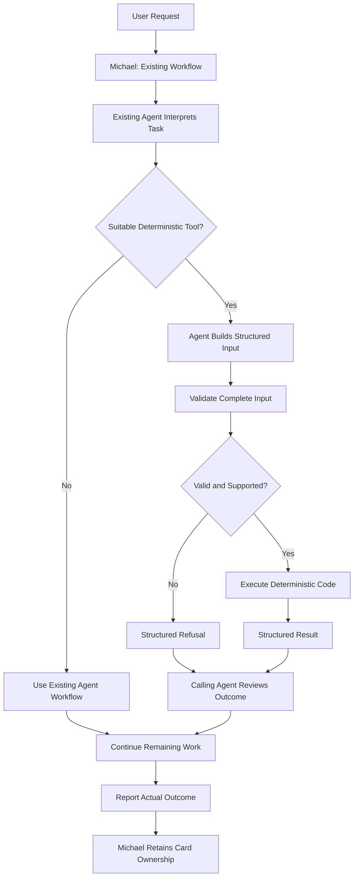
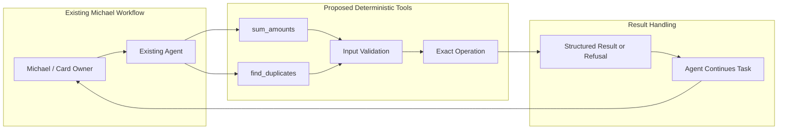

# Design Note: Code-First Tools for Repetitive Office Tasks

**Status:** Draft for maintainer review — design only  
**Related issue:** #250  
**Scope:** One or two read-only deterministic tools; no implementation or savings claimed.

## 1. Goal

Explore whether an existing agent can delegate clearly defined, repetitive operations to deterministic local code instead of spending additional LLM reasoning on the operation itself.

The objective is to reduce total token usage and end-to-end task time without reducing correctness or whole-task completion.

This proposal refines generic calculation and duplicate-detection ideas explored in PR #418. Those basic ideas are not presented as novel. The proposal focuses on strict tool contracts, safe use by existing agents, appropriate task ownership, and a fair benchmark.

No savings have been measured. Tool-schema overhead, argument construction, tool output, retries, context, and any additional model turns must all be counted.

## 2. Proposed First Tools

These are candidates for maintainer review, not existing implemented features.

| Tool | Purpose | What it must not decide |
|---|---|---|
| `sum_amounts` | Add amounts the agent has already selected from an authorized structured source. | Which invoices belong in the total, what currency conversion to apply, or whether the overall request is complete. |
| `find_duplicates` | Flag rows matching explicitly selected key fields and matching rules. | Whether similar people or businesses are truly the same, or whether records should be merged or deleted. |

The maintainer can choose one tool or both for the first prototype.

A conservative option is to prototype `sum_amounts` first and defer `find_duplicates` until a no-tool baseline demonstrates a meaningful duplicate-detection problem on representative data.

Existing connector reports, such as a QuickBooks report that already provides the requested total, should remain preferred when they already answer the request correctly.

## 3. Proposed Flow

The existing agent—not a separate keyword or regex router—decides whether a documented tool fits a particular subtask.

1. The owner submits a request.
2. The existing agent interprets the request and separates it into steps.
3. The agent checks whether a documented deterministic tool fits a specific step.
4. If no tool fits, the agent uses its existing reasoning and available tools.
5. If a tool fits, the agent supplies structured input.
6. The tool validates the complete input.
7. If the input is valid and supported, the tool performs the exact operation.
8. If the input is invalid or unsupported, the tool returns a structured refusal.
9. The calling agent checks the result and continues the remaining work.
10. The agent corrects an obvious input issue once, asks the owner, or chooses a safe alternative.
11. The agent reports the actual outcome.

A tool call completes only its own small operation. It does not imply that the user's whole request is complete.

### Diagram 1 — Proposed execution flow



### Diagram 2 — Tool boundary and responsibilities



These are proposed design diagrams, not claims about existing implementation. The actual agent mapping and tool integration path must be confirmed during maintainer review.

## 3.1. Which Team Roles Benefit, and Why?

The proposed tools are not intended for every team member or every task. They are useful only when an assigned task includes a suitable structured operation and the required data is available through an authorized source.

| Tool | Potential business function | Concrete use case | Why deterministic code helps |
|---|---|---|---|
| `sum_amounts` | Finance | Total invoice amounts already selected by the agent, calculate subtotals by client, or reconcile a set of authorized financial rows. | Exact decimal arithmetic is repeatable and avoids asking a model to perform arithmetic manually. |
| `find_duplicates` | Finance | Flag potentially duplicate invoice rows using explicit supplier and invoice-number fields. | Explicit matching rules consistently identify exact or defined normalized matches. |
| `find_duplicates` — possible later use | Inventory, Shipping, or Supply Chain | Flag repeated stock or shipment records in an authorized structured dataset. | Matching defined identifiers is repeatable and can surface records for human or agent review. |

**Why Finance is the strongest initial use case**

Finance provides a narrow starting point because adding already-selected amounts has a clear expected result and can be tested against known answers. The first prototype should therefore consider `sum_amounts` for a finance-related subtask. `find_duplicates` should be included only if baseline testing shows a meaningful need and the maintainer approves the matching contract.

These examples identify business functions and task types, not confirmed names of agents currently configured in Michael.

Before implementation, the repository's actual agent definitions and responsibilities must be inspected. The design should then map each approved tool to the existing agent, if any, whose configured responsibilities include that task. It must not invent agent names or assume that every installation has the same team structure.

Michael continues to assign work according to each team member's configured job. Only an existing agent handling a relevant subtask should call a tool, and only when its authorized data and tool access permit it. The tool must not independently select an agent, reassign a task, or decide that the whole request is complete.

## 4. Proposed Contracts

The following schemas are illustrative design contracts. Exact limits, field names, and integration details should be confirmed before implementation.

### 4.1 `sum_amounts`

**Purpose:** Add amounts that the agent has already selected.

#### Example input

```json
{
  "version": 1,
  "currency": "USD",
  "decimal_places": 2,
  "negative_amounts": "allow",
  "amount_field": "amount",
  "group_by": "client",
  "label_field": "invoice_id",
  "rows": [
    {
      "invoice_id": "INV-1001",
      "client": "Northwind Cafe",
      "amount": "1250.10"
    },
    {
      "invoice_id": "INV-1002",
      "client": "Northwind Cafe",
      "amount": "249.90"
    },
    {
      "invoice_id": "INV-1003",
      "client": "Harbor Dental",
      "amount": "975.50"
    }
  ]
}
```

#### Expected result

- Overall total: `2475.50`
- Northwind Cafe subtotal: `1500.00`
- Harbor Dental subtotal: `975.50`

#### Example success response

```json
{
  "ok": true,
  "tool": "sum_amounts",
  "version": 1,
  "currency": "USD",
  "row_count": 3,
  "total": "2475.50",
  "groups": [
    {
      "key": "Northwind Cafe",
      "total": "1500.00"
    },
    {
      "key": "Harbor Dental",
      "total": "975.50"
    }
  ]
}
```

#### Example refusal response

```json
{
  "ok": false,
  "tool": "sum_amounts",
  "version": 1,
  "error_code": "INVALID_AMOUNT",
  "message": "Amount must be a valid decimal string.",
  "affected_rows": ["INV-1002"],
  "affected_fields": ["amount"],
  "agent_action": "fix_input"
}
```

#### Validation and refusal rules

Refuse the request when:

- Required fields are missing or have the wrong types.
- An amount is not a valid decimal string at the declared precision.
- Currency or precision settings are invalid or unsupported.
- A negative amount violates the declared policy.
- The input exceeds an agreed size or row limit.
- A requested grouping or label field cannot be interpreted safely.

The tool must not silently skip invalid rows, guess or round invalid values, convert currencies, select which records count, or change source records.

Validate every row before returning a total. Use exact decimal or integer minor-unit arithmetic rather than binary floating-point addition.

The agent remains responsible for selecting the correct records and explaining the result in the context of the original request.

### 4.2 `find_duplicates`

**Purpose:** Flag records that match under explicitly selected key fields and a defined matching mode.

#### Example input

```json
{
  "version": 1,
  "key_fields": ["supplier", "invoice_no"],
  "match": "normalized",
  "missing_key": "refuse",
  "label_field": "invoice_no",
  "rows": [
    {
      "supplier": "Acme Paper",
      "invoice_no": "A-77",
      "amount": "410.00"
    },
    {
      "supplier": "ACME  paper",
      "invoice_no": "a-77 ",
      "amount": "410.00"
    },
    {
      "supplier": "Acme Paper",
      "invoice_no": "A-78",
      "amount": "95.25"
    }
  ]
}
```

#### Matching rules

The initial design supports two matching modes:

- `exact`: compare the selected key values exactly.
- `normalized`: apply an explicitly documented normalization rule before comparison.

For the example above, normalized matching should treat the first two rows as a possible duplicate group because the supplier and invoice number differ only in case and surrounding or repeated whitespace. The third row should not match that group.

For version 1, normalized matching should be limited to trimming leading and trailing whitespace, collapsing repeated internal whitespace, and case-folding text. It must not perform fuzzy matching, spelling correction, abbreviation expansion, or semantic matching.

All selected key fields must match for rows to belong to the same group.

#### Illustrative success response

```json
{
  "ok": true,
  "tool": "find_duplicates",
  "version": 1,
  "match": "normalized",
  "row_count": 3,
  "duplicate_groups": [
    {
      "group_id": 1,
      "key": {
        "supplier": "acme paper",
        "invoice_no": "a-77"
      },
      "rows": [
        {
          "row_index": 0,
          "label": "A-77"
        },
        {
          "row_index": 1,
          "label": "a-77 "
        }
      ]
    }
  ]
}
```

This response is illustrative. The implementation should settle on one stable representation for normalized keys and row references before coding.

#### Validation and refusal rules

Refuse the request when:

- Required fields are missing or have unsupported types.
- `key_fields` is empty or refers to unavailable fields.
- The matching mode is not `exact` or `normalized`.
- The missing-key policy is unsupported.
- The input structure or size is invalid.
- A selected key is missing while `missing_key` is set to `refuse`.

Under `missing_key: "refuse"`, any row missing a selected key causes the whole call to be refused. The tool must not return a partial result as if the complete dataset had been checked.

The tool must not fuzzy-match similar names, merge or delete records, or declare that flagged rows definitely represent the same real-world entity. It only identifies rows that match the supplied rules.

### 4.3 Shared Contract Rules

Both tools should follow these rules:

1. Include a contract version in requests and responses.
2. Validate the complete input before processing.
3. Return stable error codes, a plain-language reason, affected rows or fields where applicable, and a safe next action.
4. Never label partial output as complete success.
5. Remain read-only: do not modify cards, invoices, inventory, or other business records.
6. Do not invoke an LLM or chain into other tools.
7. Enforce documented input-size and row-count limits.
8. Keep errors predictable and machine-readable.
9. Allow the calling agent to correct an obvious input issue once. If the request remains unsupported, the agent should ask the owner or choose a safe alternative.
10. Keep responsibility for the overall task with the existing agent and owner.

## 5. Delivery Through Existing Patterns

**Proposal:** Reuse the smallest supported existing agent-tool delivery pattern, subject to maintainer confirmation, instead of introducing a new routing layer.

A local CLI or script exposed through existing shell or skill instructions is one candidate. The implementation should first confirm the current branch's actual distribution, permissions, and invocation mechanism before selecting a delivery path.

Relevant repository locations to inspect include:

- `resources/skills/`
- `resources/kg.cjs`
- `src/main/kg-core.cjs`
- `src/main/hive.ts`
- `src/shared/mcpCatalog.ts`
- `src/shared/claudeConnectors.ts`
- `resources/md-mail-mcp.cjs`

These are inspection targets, not proof that the proposed tools already exist or that any one path is approved. The design should be mapped to the actual tool-delivery pattern used by the intended agent, rather than assuming every agent has the same capabilities.

The implementation must not introduce:

- An independent keyword or regex router.
- Automatic model or provider switching.
- Automatic card creation, movement, or completion.
- A second system that competes with Michael for ownership of work.

Michael remains responsible for card ownership and completion.

## 6. Agent-to-Agent Handoff: Separate Future Possibility

The repository review at commit `45ece300` reported that agents run in separate sessions, mail is transported by main-process code, and the message body is a string. The review did not identify a typed tool-to-agent channel that forwards a tool result directly to another agent.

Delivery or waking an agent does not itself require an LLM call, but the sender normally spends output tokens authoring a message and the recipient spends a model turn reading and acting on it.

Therefore, this proposal does not assume that direct `tool → Agent B` handoff is already supported. In the first design, the deterministic tool returns its result to the calling agent.

Any future direct structured handoff or file-reference pattern should be researched as a separate architecture question and approved before implementation.

Potential future comparisons, not commitments:

1. Existing agent workflow without the proposed tool.
2. Agent → tool → same agent continues.
3. Agent A → tool → Agent B.
4. Agent A → Agent B without a tool.

A direct message or data transfer may avoid copying bulky content, but it does not necessarily avoid the recipient's model turn. For small outputs, such as one total, an additional handoff may cost more than it saves.

Any token-savings claim must count prompt and tool descriptions, arguments, results, context injected into each agent, sender message tokens, receiver turns, retries, latency, and cost where available.

## 7. Benchmark Plan

Compare the same representative task under two conditions:

- **Baseline:** the tool is not available.
- **Tool-assisted:** the approved deterministic tool is available to the relevant existing agent.

Keep task wording, input data, model/provider, and settings as comparable as possible. Use fresh comparable sessions and repeat the conditions.

Record:

- Correctness against a known expected result.
- Whole-task completion, not just whether the tool operation succeeded.
- Input, output, and cached tokens where available.
- End-to-end time, including argument preparation and tool overhead.
- Tool calls, refusals, retries, errors, incomplete runs, and incorrect runs.
- Per-run cost, if reliable data is available.

Report failures separately; do not hide them in averages. If per-step token attribution or model-call counts are unavailable, state that limitation rather than inventing data.

Small tasks may cost more with a tool. A faster but incorrect or incomplete result is not a win.

No implementation or benchmark is requested in this design phase. Benchmarking is a later decision gate after the maintainer approves the design.

## 8. Questions for Maintainer Review

1. Should the first prototype cover `sum_amounts` only, or both proposed tools?
2. Which existing configured agent or agents actually handle the relevant finance or record-checking subtasks?
3. Which existing delivery path should be reused for an agent-facing deterministic tool?
4. Which anonymized representative inputs and expected outputs should be used?
5. Which token, correctness, completion, timing, and cost measurements are available in current telemetry?
6. Is the agent-to-agent handoff question out of scope for this first prototype, as proposed here?

The actual agent-to-task mapping should be confirmed from the repository's configured team definitions before implementation. If no existing agent owns a suitable task, the prototype should not invent a new agent or silently reassign work.

## 9. Proposed Phases

| Phase | Work | Decision gate |
|---|---|---|
| 1. Design review | Agree on scope, contracts, actual agent mapping, delivery path, and benchmark. | Maintainer approval. |
| 2. Prototype | Implement only the approved scope; test valid and invalid inputs and edge cases. | Safe, predictable test results. |
| 3. Measure | Compare baseline and tool-assisted runs. | Evidence on correctness, tokens, time, and failures. |
| 4. Expand only if justified | Consider the second tool or other repetitive operations. | Measured benefit supports expansion. |

## Closing

Let agents focus on understanding, ambiguity, and decisions; let deterministic local code handle narrow repetitive operations it can perform exactly.

Keep the first step small, preserve existing ownership controls, verify which existing agent actually benefits, and let measurement—not assumptions—decide whether the design should expand.
